# NagarShield 360 — unified city operations roadmap

## Product promise

Help the people already running the city see connected problems earlier, choose a practical response, coordinate existing teams, and verify whether the problem stayed solved. Citizen reports are one source alongside field work, approved camera views, approved drone surveys, asset records and weather. Recommendations explain their evidence and uncertainty; an authorized official owns every decision.

This is a **decision and operations platform**, not autonomous enforcement. The goal is more useful coverage and faster, better work with the same workforce. A real pilot must prove the improvement.

## The complete case journey

```mermaid
flowchart LR
  A[Citizen, field, CCTV, drone, city data] --> B[Source and permission check]
  B --> C[Observation review and duplicate linking]
  C --> D[Ward map and drainage/road connections]
  D --> E[Explainable cause and priority options]
  E --> F[Official approval and one case owner]
  F --> G[Multi-team mission and route]
  G --> H[Offline field updates and evidence]
  H --> I[Supervisor verification]
  I --> J[Repeat check, map correction and learning]
  J --> D
```

One case can hold several observations and several department tasks. A camera frame never proves what is inside a drain. A still image never proves mosquito larvae. A drainage connection is a hypothesis until a field engineer confirms it. The system must preserve those distinctions in the data and the UI.

## What works today and what this prototype demonstrates

| Capability | Current state | Next production step |
|---|---|---|
| Citizen reports, official review, incidents, assigned tasks, evidence and supervisor approval | Shared Supabase workflow in the two clients | Keep as the authoritative work record; improve real pilot roles and audit |
| Drone/GapScan survey entry and local media annotation | Mobile prototype; no hardware control or inference | Approved survey plan, georeferenced media, consent and upload pipeline |
| Official web dashboard, map, media studio and reports | Private authenticated prototype | Join each reviewed media item and mapped asset to an operational case |
| Four connected cases across waste, drains, roof/gap water, footpaths, sewage and emergency access; map trace, camera blind areas, capacity-aware assignment, partner acknowledgement, first-responder handoff and repeat checks | **Seeded local rehearsal** in private web `/operations` and the app (also offline Local Demo) | Replace local state with reviewed, permissioned records in Supabase |
| Live CCTV ingestion, automatic detection, real drone flight, validated drainage model, weather triggers and route optimization | **Not connected** | Pilot only after owner agreements, engineering checks, privacy rules and measurable validation |

The web stays official-only. The app's offline Local Demo is a presentation environment, separate from the real citizen and official workflow. Sample overlays, boxes, confidence, map coordinates, flight routes, score adjustments, task assignment, partner acknowledgement, responder clearance and verification in the Operations screen are illustrative. No control or message is sent to a drone, CCTV system, city team or emergency unit.

## Distinctive decisions to develop

1. **Confidence-aware triage.** A recommendation records its sources, freshness, model version, coverage and limitations. Low-confidence or conflicting evidence creates a field-inspection task instead of an automatic conclusion.
2. **Coverage-gap planning.** Show which streets a permitted camera can see, where buildings hide the ground and which approved drone or walking survey could close the gap. Missing coverage is visible, not silently treated as a clean area.
3. **Network-first drainage reasoning.** Follow surveyed inlets, drains, culverts and outlets. Offer a downstream inspection lead with the exact path used. Do not call this a hydraulic flood prediction until engineering models and measurements exist.
4. **One connected mission.** A ward case owner can coordinate waste, drainage, public-space, traffic and health subtasks. Each has a named team, access needs, equipment, evidence requirement and escalation owner.
5. **Displacement and recurrence.** Repeated footpath obstruction on the next road or a drain that fails after every cleaning should trigger a corridor or engineering review, rather than endlessly repeating the same work order.
6. **Resource-aware field visits.** Suggest a visit using skill, shift, equipment, vehicle access and nearby jobs. Dispatchers can edit the route and record why.
7. **Reversible priorities.** Rain, hospital access or a new field report may change the order. Show what is delayed and require an official to approve changes to active work.
8. **Verified impact.** Compare before/after evidence, revisit after rain or at the same busy hour, record recurrence, and feed map corrections into later recommendations.
9. **Shared city coordination.** A case owner sees acknowledgements and blockers across city teams, utilities, property owners, market groups and emergency responders. Escalation and a citizen-update draft stay attached to the case; a draft is never silently published.
10. **First-responder handoff.** For a road crash or fire, police/medical or Fire Service leads the scene. The city shares access and asset information, records which units acknowledged, and waits for the lead's clearance before restarting its own work.
11. **Hidden-space inspection.** A street camera's blind area can point to a permitted field visit of a building gap or roof garden. Health staff inspect water containers; imagery alone cannot diagnose breeding.

These are product capabilities, not claims that the present prototype has trained models or citywide data.

## Shared data contract for the pilot

Keep the existing `observations`, `incidents`, `tasks`, `events`, `infrastructure` and profile/RLS model. Add reviewed, additive migrations rather than replacing the working workflow.

| Record | Minimum fields | Responsible owner |
|---|---|---|
| `city_assets` and `asset_edges` | Stable asset ID, type, geometry, upstream/downstream edge, verification status, last field check and revision | DNCC/GIS with drainage engineers |
| `media_sources` | Owner, permitted purpose, coverage geometry, access scope, retention and feed health | Camera owner, drone operator and DNCC data steward |
| `survey_plans` | Case, area polygon, route, launch point, operator, approval references, constraints and flight outcome | Authorized survey officer |
| `media_observations` | Source, captured time, received time, location/accuracy, private media key, quality, reviewed findings and uncertainty | Reviewing officer; model service may propose findings |
| `observation_links` | Several observations linked to one incident, duplicate reason and reviewer | Ward case owner |
| `recommendations` | Candidate action, factors, accepted evidence IDs, model/rule version, alternatives, uncertainty and generated time | Decision service; official approves/overrides |
| `mission_cases` | Incident/area, case owner, approved plan, priority, access/equipment needs and escalation | Ward operations lead |
| Existing `tasks` plus mission link | Department, assignee, due time, route stop, status, evidence requirement and idempotency key | Department supervisor |
| `verification_checks` | Who checked, site result, before/after keys, recurrence schedule and map correction | Supervisor and engineer/health specialist |
| `partner_handoffs` | Case, organization, requested action, acknowledgement, blocker, escalation owner and timestamp | Ward case owner and receiving organization |
| `response_incidents` | Incident commander, responding units, safe access route, scene status, clearance authority and handoff time | Police/medical or Fire Service lead; DNCC supports |
| `citizen_updates` | Reviewed message, case/status reference, approving officer, channel and delivery result | Authorized communication officer |

All footage remains private. Use signed, short-lived access or authenticated server routes; never store service-role credentials in either client. Keep citizen identities out of shared camera views. Every priority override, media rejection, map correction and assignment needs an audit event. Apply RLS to every new table before a client reads it. The offline app queues only authorized actions with idempotency and clear rejected-action feedback.

### Review and decision rules

- Store **captured time** separately from upload time. A fresh upload can still contain old footage.
- Keep raw findings separate from a human-reviewed conclusion. A sample detection label is never silently promoted to fact.
- Treat “no detection” as “nothing detected in this view,” not “the area is clear.”
- Link duplicates without deleting their sources. Keep multiple streets separate when a blockage shifts location.
- Version drainage edges and keep “unknown” as a first-class state. Field corrections require attribution and approval.
- Route proposals must include access and equipment constraints; a dispatcher owns the final assignment.
- Health teams confirm breeding sites; civil/drainage engineers confirm causes; city officers approve operations.

## Delivery sequence and acceptance gates

### 0. Freeze the demo contract

Keep the web/app seed identical, label sample imagery and make the five-step walkthrough reliable on desktop and phone. Preserve the private web boundary and the existing live Incident/Task flow. **Gate:** both builds pass, sample steps can be completed offline in the app, and no seeded action changes Supabase records.

### 1. One-ward asset and observation pilot

Choose one ward and a small corridor with DNCC. Survey drains, culverts, outlets, footpaths and critical facilities; assign stable asset IDs and confidence/verification status. Add field map correction and reviewed observation links. **Gate:** engineers can follow and correct every displayed drainage path; an officer can trace every case back to evidence and its timestamp.

### 2. Permissioned imagery ingestion

Agree with CCTV owners and public agencies on purpose, feed boundaries, retention and emergency fallback. For drones, obtain operator/airspace/property approvals and keep the application as a survey planner, not a flight controller. Ingest short clips/stills with source metadata, coverage area and privacy masking. **Gate:** no unapproved feed is visible, failure falls back to field reports, and a reviewer can accept/reject a finding with a reason.

### 3. Validated decision support

Build a local labeled dataset from the pilot area. Evaluate false positives, misses, stale evidence and performance across rain, darkness, occlusion and camera angles. Start with transparent rules and inspected drainage graphs; add models only where they outperform the baseline. Show factors, alternatives and uncertainty. **Gate:** domain reviewers approve the evaluation set and a human can override every recommendation; unsafe or low-confidence cases request inspection.

### 4. Mission and resource planning

Connect mapped assets and accepted evidence to an incident. Create one mission owner and department tasks through the existing authorization path. Add skills, shift, equipment, travel/access and nearby-job constraints; support offline field updates. **Gate:** no task goes to an unauthorized team, duplicate retries do not duplicate work, and a supervisor sees every change in one case timeline.

Add partner requests with acknowledgement, blocker and escalation states. External organizations receive only the case details they are allowed to see. Let a communications officer approve a citizen-facing update from verified case status. For crash or fire support, record the actual incident commander and their scene release before DNCC crews resume. **Gate:** a blocked handoff has a named owner, no sample acknowledgement is treated as a real dispatch, and no emergency scene is marked safe by this app.

### 5. Verification, prevention and crisis rehearsal

Require appropriate before/after evidence and field checks, then schedule a recurrence visit after the next rain or at the same busy hour. Introduce weather and emergency re-prioritization only with official approval and an impact preview. **Gate:** the pilot can measure repeat failure and time from first signal to verified resolution, and can explain every emergency reassignment.

## Stakeholder decisions before a real pilot

| Stakeholder | Decision needed | Failure handling |
|---|---|---|
| DNCC executive and ward lead | Pilot boundary, case owner, escalation and decision authority | One named owner per case; unresolved cross-department work escalates |
| Drainage/civil engineering | Asset graph, field correction and safe intervention | Unknown or conflicting connections become inspection jobs |
| Waste, public-space, traffic and health teams | Task scope, equipment, access and verification evidence | Separate subtasks and specialist sign-off; no image-only health diagnosis |
| Camera owners, drone operators and aviation/security authorities | Permitted coverage, flight conditions, retention and access | Feeds stop when approval expires; use walking/field survey fallback |
| Residents, markets, property owners and community groups | Access, local feedback and follow-up | Record disagreement and repeat obstruction, protect personal evidence |
| ICT, cybersecurity and research partners | RLS, audit, backups, model evaluation and incident response | Role-limited access, human approval and versioned rollback |

## How to measure the pilot

Before rollout, capture a baseline for one ward. Compare **time from first credible signal to assignment**, **time to field-verified resolution**, **time lost waiting for partner acknowledgement**, **area inspected per staff hour**, **duplicate reports merged correctly**, **repeat failures**, **missed/false media findings**, **task travel and equipment fit**, and **resident/field-worker feedback**. Report the denominator and the time window; do not claim citywide impact from four seeded cases.

For the existing integration test and recording plan, see [`INTEGRATION_TEST_AND_RECORDING_PLAN.md`](../INTEGRATION_TEST_AND_RECORDING_PLAN.md). In the recording, show the map's drainage path, an approved survey area, a CCTV clip with its blind spot, an evidence toggle changing the explained recommendation, a map-selected mission task and the verification step. State aloud that these are sample inputs and that the official workflow is the real shared-data part of the prototype.
